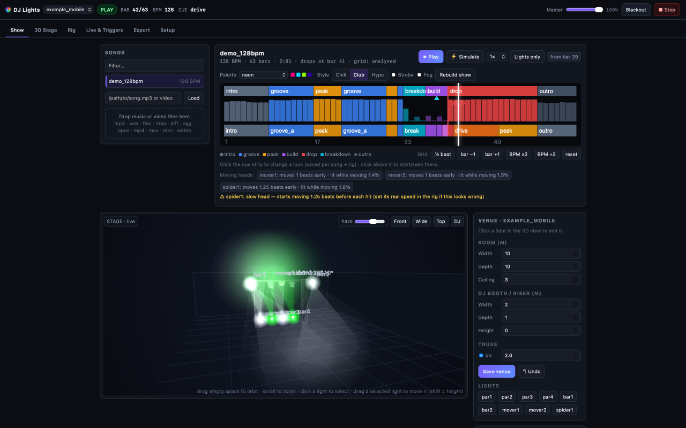
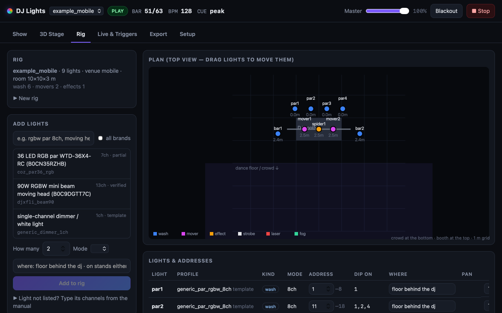
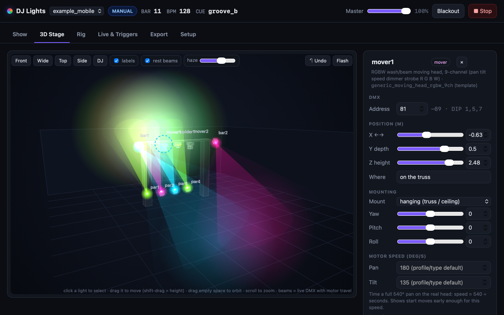
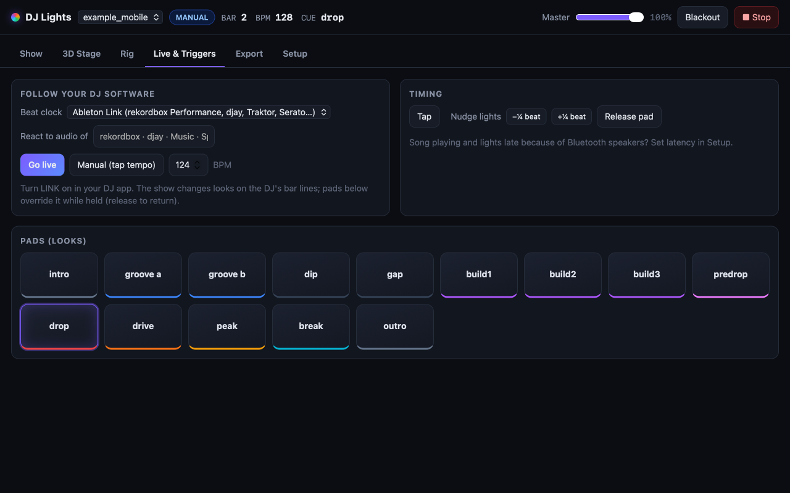
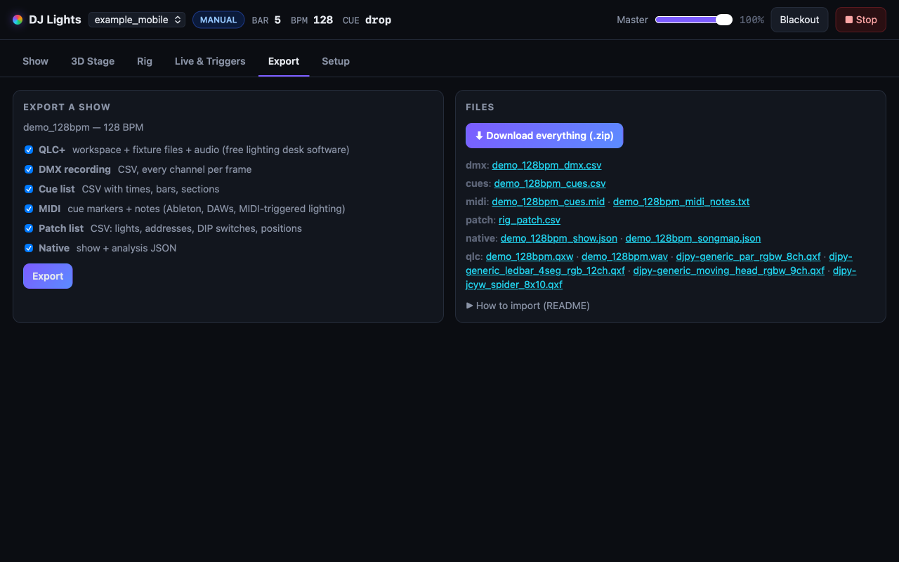

<div align="center">

# 🎛️ DJ Lights

**DMX light shows that follow the music — for any DJ, any lights, any song.**

Web app with a live 3D stage · plain-word rig setup · automatic shows from any audio/video file ·
in-sync playback · live mode for rekordbox / djay / Traktor · QLC+ & MIDI exports · an MCP server so Claude, Codex or Cursor can run it all by chat.

[](https://github.com/gatordevin/dj-lights/actions/workflows/tests.yml)




</div>

---

## Contents
- [What it does](#what-it-does) · [Quick start](#quick-start) · [Hardware](#hardware)
- [Set up your lights](#1-set-up-your-lights) · [Make a show for a song](#2-make-a-show-for-a-song) · [Play, simulate, go live](#3-play-simulate-or-go-live)
- [The web app](#the-web-app) · [Command line](#command-line) · [Chat / AI agents (MCP)](#use-it-from-a-chat-claude-codex-cursor)
- [Exports](#exports) · [Moving heads](#moving-heads-and-motor-speed) · [Safety](#safety) · [Troubleshooting](#troubleshooting)
- [How it works](#how-it-works) · [Accuracy](#accuracy) · [Project layout](#project-layout) · [Contributing](#contributing)

## What it does

| | |
|---|---|
| 🎚️ **Any lights** | 16 generic fixture layouts (RGB / RGBW / RGBWA+UV pars, LED bars, moving heads, colour-wheel spots, strobes, fog), any brand from the [Open Fixture Library](https://open-fixture-library.org), or type the channel list from your light's manual. |
| 📍 **Any room** | Place lights in plain words — *"4 pars on the floor behind the dj"*, *"2 moving heads on the truss"*, *"stands either side"*. DMX addresses and DIP switch settings are worked out for you. Drag lights around in 3D. |
| 🎵 **Any song** | mp3, wav, aiff, flac, m4a/aac/alac, ogg, opus and the audio track of mp4 / mov / mkv / webm → tempo, beat grid, bars, **drops, builds, breakdowns**, intro/outro (~0.3 s per song). Use your **rekordbox** beat grids if you have them. |
| 💡 **Shows that fit your rig** | Build-ups that grow, a **dark beat before every drop**, full hits on the drop, slow fades in breakdowns; 12 palettes; club / chill / hype styles; edit any section's look on the timeline. |
| 🔄 **Real moving-head physics** | Heads travel at their real speed and **move in the dark**, beams are aimed above the crowd's eyes, and every show reports how often a head is lit while still moving. |
| ▶️ **Play it** | In sync with the song, **simulate at up to 16×** and scrub, or go live following your DJ software over **Ableton Link** (or Pioneer Pro DJ Link) and reacting to its audio. |
| 📦 **Export** | QLC+ workspace, DMX frame recording (CSV), cue list (CSV), MIDI cue track, patch list. |
| 🤖 **AI-ready** | An MCP server with 32 tools, a skill file for Claude Code, and JSON output on every command. |

## Quick start

```bash
git clone https://github.com/gatordevin/dj-lights.git && cd dj-lights
brew install ffmpeg                      # Linux: sudo apt install ffmpeg
python3 -m pip install -r requirements.txt
python3 lighting/dj.py doctor            # what works on this machine
python3 examples/make_demo_track.py      # optional: a 128 BPM demo song with a build and a drop
python3 lighting/dj.py web --open        # the web app → http://127.0.0.1:8790
```

No hardware needed to try it: without a DMX interface everything runs in **simulation** and you watch it in the 3D view.
In the web app pick the `example_mobile` rig, drop `examples/demo_128bpm.wav` (or any song) on the Show tab and press ⚡ **Simulate**.

**Requirements:** Python 3.11+, `numpy`, `ffmpeg`. macOS is the main platform (tested on Apple Silicon); Linux runs the web
app, CLI, analysis, simulation and Art-Net (USB-DMX on Linux uses `/dev/ttyUSB*` and is untested on real hardware). Windows is
not supported (POSIX serial).

## Hardware

| Interface | Status |
|---|---|
| FTDI "Open DMX" style USB dongles — e.g. **DSD TECH SH-RS09B**, Enttec Open DMX USB | ✅ auto-detected (`--port auto`), hot-plug |
| **Art-Net** nodes / Wi-Fi DMX boxes / software visualisers | ✅ `--artnet 192.168.1.50` |
| Enttec DMX USB **Pro**, SoundSwitch Micro DMX and other "smart" interfaces | ❌ not yet (different protocol) |

One DMX universe (512 channels). Lights must be in **DMX mode** (display usually `d001` / `A001`, or DIP switches) at the
address the app gives you. Daisy-chain the DMX cables and put a terminator on the last light if the run is long.

## 1. Set up your lights

**Web app → Rig tab:** search for your light (tick *all brands* to search the Open Fixture Library), say how many and where,
press *Add*. Then fine-tune positions on the 3D Stage tab (drag, or use the inspector).

**Or on the command line:**
```bash
python3 lighting/dj.py rig new gig --venue mobile --truss        # venues: mobile, club, stage, backyard, living_room
python3 lighting/dj.py fixtures find rgbw par                    # local profiles (add --ofl to search every brand)
python3 lighting/dj.py fixtures import chauvet-dj/slimpar-pro-h-usb       # any Open Fixture Library light
python3 lighting/dj.py fixtures new my_par --channels "dimmer,red,green,blue,strobe,mode,speed"   # from the manual
python3 lighting/dj.py rig add gig generic_par_rgbw_8ch --count 4 --where "floor behind the dj"
python3 lighting/dj.py rig add gig generic_moving_head_rgbw_9ch --count 2 --where "on the truss"
python3 lighting/dj.py rig sheet gig                             # address + DIP switches to dial on each light
python3 lighting/dj.py use gig                                   # make it the default
python3 lighting/dj.py test                                      # each light flashes in turn — check they match
```
or run `python3 lighting/dj.py setup` for a guided terminal walkthrough.

**Place words:** sides `left`, `right`, `center`, `far left`, `either side` (left/right **as the crowd sees it**; `stage left` /
`dj left` mean the DJ's own left) · spots `truss`, `ceiling`, `stand`/`t-bar`, `floor`/`uplight`, `booth`, `behind`, `front`,
`over the crowd`, `wall` · heights `2.5m`, `8ft`. Exact coordinates: `--pos x,y,z` (metres; x = crowd's right, y = away from
the crowd, z = up).

| Rig tab | 3D Stage tab |
|---|---|
|  |  |

## 2. Make a show for a song

Pick or drop a song on the **Show** tab. It is analysed (beats, bars, sections, drops) and a show is built for your rig:
the cue strip under the timeline is the plan. Change the palette or style, tick *Strobe* / *Fog* if you want them, and click any
cue block to change that section's look (saved per song and rig). Command line:

```bash
python3 lighting/dj.py analyze song.mp3                      # BPM, bars, sections, drops
python3 lighting/dj.py show song.mp3 --palette neon --style hype --preview
```

**Beat grid off?** `½ beat` (hits land between beats), `bar ±1` (looks change a beat early/late), `BPM ×2 / ÷2` — buttons on
the timeline, or `dj.py fix song.mp3 --shift 0.5 | --bar 1 | --bpm 128`. rekordbox users: export your collection as XML and
`dj.py settings rekordbox_xml=/path/collection.xml` to use your own grids.

## 3. Play, simulate or go live

- **▶ Play** — the song and the lights together. Bluetooth/wireless speakers lag: set *Speaker latency* in Setup
  (`dj.py settings latency_ms=150`).
- **⚡ Simulate** — the show without audio at 1–16×; click the timeline to jump. Great for checking a whole set quickly.
- **Lights only** — lights in real time while your DJ software plays the track.
- **Live & Triggers** — for real DJ sets: turn **LINK** on in rekordbox (Performance mode) / djay / Traktor / Serato, press
  *Go live*; the looks change on the DJ's bar lines and pulse with the music. Pads switch looks on demand.

```bash
python3 lighting/dj.py play song.mp3 --console          # + web console on :8779
python3 lighting/dj.py live --clock link --audio rekordbox
```



## The web app

`python3 lighting/dj.py web --open` → **http://127.0.0.1:8790**

| Tab | What you do there |
|---|---|
| **Show** | song library + drag-and-drop upload; timeline with energy, sections, drops, the cue plan (click to edit) and a playhead; Play / Simulate (1–16×) / Lights only; palette, style, strobe, fog; grid fixes; live 3D view; per-light colour swatches; a whole-song preview image |
| **3D Stage** | full-size live 3D view (beams, haze, floor pools, motor travel). **Click a light** to select it, **drag** to move it (**shift-drag** = height). The inspector edits address, mode, position, yaw/pitch/roll, mounting, aim, **motor speed**, pan direction; with nothing selected it edits the venue (room, booth, truss). Undo. |
| **Rig** | add lights (search, all brands, or type channels), drag-to-place top-view plan, address / DIP / mode table, flash each light, warnings |
| **Live & Triggers** | follow Ableton Link / Pro DJ Link / manual tap tempo, react to an app's audio, look pads, tap, nudge |
| **Export** | pick formats → one zip (with an import guide) |
| **Setup** | output (USB / simulation / Art-Net), speaker latency, music folder, rekordbox XML, slow-mover setting, chat setup |

Top bar everywhere: rig, mode, bar / BPM / cue, **master**, **blackout**, **stop**.



## Command line

Everything in the web app is also a command (`--json` on most for scripts and agents):

```text
python3 lighting/dj.py setup | doctor | use RIG | settings [key=value ...]
                       fixtures list | find WORDS [--ofl] | show NAME | import maker/fixture | new NAME --channels "..."
                       rig new|add|move|set|remove|rename|sheet|check|venues|places ...
                       test [RIG] [LIGHT]            point [RIG] LIGHT dancefloor|dj|up|back|crowd|ceiling|x,y,z
                       analyze FILE|FOLDER [--bpm N] [--vocals]      fix FILE [--shift 0.5] [--bar 1] [--bpm 128] [--clear]
                       show FILE [--palette P] [--style club|chill|hype] [--strobe] [--fog] [--preview]
                       play FILE [--start-bar N] [--latency-ms 150] [--console] [--no-audio] [--volume 0..1]
                       crate FOLDER       export FILE [--formats qlc,dmx,cues,midi,patch,native]
                       live [--clock link|prodjlink|internal] [--audio rekordbox]      web [--port 8790] [--open] [--lan]
Outputs (any light command): --port auto | none | /dev/cu.usbserial-X     --artnet HOST
```

Full module reference, recipes and limits: [`lighting/README.md`](lighting/README.md).

## Use it from a chat (Claude, Codex, Cursor)

The MCP server gives an AI assistant the same controls: build a rig from a description, analyse songs, make, preview, edit,
simulate and play shows, export, open the web app.

- **Claude Code** — opening this repo picks up [`.mcp.json`](.mcp.json) automatically (approve it once), or add it everywhere:
  ```bash
  claude mcp add --scope user dj-lights -- python3 "$PWD/lighting/mcp_server.py"
  ```
  and copy the skill: `mkdir -p ~/.claude/skills && cp -r skills/dj-lighting ~/.claude/skills/`
- **Codex** — `~/.codex/config.toml`:
  ```toml
  [mcp_servers.dj-lights]
  command = "python3"
  args = ["/ABSOLUTE/PATH/dj-lights/lighting/mcp_server.py"]
  ```
- **Claude Desktop / Cursor / others** — `{"mcpServers": {"dj-lights": {"command": "python3", "args": ["/ABSOLUTE/PATH/dj-lights/lighting/mcp_server.py"]}}}`

Then just ask: *"Set up my lights: 4 RGBW pars behind me and 2 moving heads on a truss"*, *"Make a hype show for
~/Music/track.mp3, show me the preview, then simulate it at 8×"*, *"Make bars 33–40 a breakdown look"*, *"Export it for QLC+"*.

32 tools: `lights_status`, `list_rigs`, `rig_details`, `create_rig`, `add_lights`, `edit_light`, `set_venue`, `remove_lights`,
`find_fixtures`, `import_fixture`, `create_profile`, `analyze_song`, `fix_grid`, `make_show`, `preview_show`, `edit_cue`,
`stage_snapshot`, `play_song`, `simulate_song`, `seek`, `set_sim_speed`, `go_live`, `manual_mode`, `trigger_cue`, `release_cue`,
`set_master`, `stop_lights`, `test_lights`, `point_light`, `export_show`, `open_web_app`, `settings`. The agent playbook is
[`skills/dj-lighting/SKILL.md`](skills/dj-lighting/SKILL.md); other agents read [`AGENTS.md`](AGENTS.md).

## Exports

| Format | File | Use it for |
|---|---|---|
| **QLC+** | `SONG.qxw` + `fixtures/*.qxf` + the audio | the free [QLC+](https://www.qlcplus.org) desk: fixtures patched at their addresses, a Show with the light sequence and the audio on a timeline |
| **DMX recording** | `SONG_dmx.csv` | every channel value per frame (30 fps) — spreadsheets, custom players, other tools |
| **Cue list** | `SONG_cues.csv` | start time, bar, cue, section — markers for timecode / cue-list software |
| **MIDI** | `SONG_cues.mid` | tempo, a marker per cue, a note per cue and drops — Ableton or any DAW, MIDI-triggered lighting |
| **Patch list** | `rig_patch.csv` | lights, addresses, DIP switches, positions |
| **Native** | `SONG_show.json`, `SONG_songmap.json` | re-play here: `dj.py play SONG --show SONG_show.json` |

Each export is a zip with a `README.txt` explaining the import. The QLC+ files follow QLC+'s XML formats (checked against its
source) but have not yet been opened in QLC+ itself — feedback welcome.

## Moving heads and motor speed

Real moving heads take time to travel. Every light has a top pan/tilt speed (profile, type default, or measured by you) that the
speed channel slows down. The 3D view shows where heads **really** point while they move (↻ shows how far a head is still behind),
and shows are planned around it: spots are visited in short-travel order, each head starts moving early enough for its longest
move and is held **dark while travelling**, and too-slow heads snap less often. Each show reports *"lit while moving"* per head.

**Measure your head:** time a full pan (e.g. 540° in 3 s → 180°/s) and enter it in the 3D Stage inspector or
`dj.py rig set gig mover1 pan_speed=180 tilt_speed=130`.

## Safety

- **Strobes** are used only when you tick *Strobe* (photosensitive guests), and then only as single flashes on drops; no light
  flashes harder than about 3 times per second.
- **Lasers** are never driven by automatic shows; laser channels stay off unless you arm a laser yourself. Check your local laser
  rules and keep beams above head height.
- **Moving-head beams** are aimed at spots that keep them out of the crowd's eye zone; when a rig cannot (heads hung low under a
  low ceiling) the show says so.
- **Fog** only with *Fog*: short bursts before drops with enforced rest time.
- **The web app has no login.** It listens on `127.0.0.1` only and refuses requests from other websites (DNS rebinding and
  cross-site protection). `--lan` lets phones/tablets on your network control it — use it only on networks you trust.
- Every command blacks out the lights when it stops or on Ctrl-C.

## Troubleshooting

| Problem | Try |
|---|---|
| Lights don't react at all | `dj.py doctor` (dongle seen?); light in DMX mode (`d001`/`A001`, not auto/sound); address matches `rig sheet`; DMX cable chain; another program (QLC+, SoundSwitch) holding the dongle |
| Wrong colours / wrong channels | the profile doesn't match the light's mode — `dj.py test RIG LIGHT` walks the channels; pick the right mode or make a profile from the manual |
| Moving head swings the wrong way | inspector *flip* (or `rig set RIG LIGHT invert_pan=true`), check with *Aim test* / `dj.py point` |
| Lights on the off-beat / a beat early | grid fix buttons (`½ beat`, `bar ±1`), or rekordbox XML |
| Lights late compared with the sound | *Speaker latency* in Setup (Bluetooth speakers: 150–250 ms) |
| Heads light up while still moving | measure and set their speed; *Slow movers* in Setup |
| `ffmpeg not found` / can't read a file | install ffmpeg; files with no audio track can't be analysed |
| Port 8790 busy | `dj.py web --port 8791` |

## How it works

```
 audio/video file ──ffmpeg──► songmap (tempo, beat grid, downbeats, bars, energy, sections, drops)   ◄─ rekordbox XML / grid fixes
                                    │
 rig (lights + places) ──► autoshow (cue per bar for the lights you have; IK aim; motor-speed-aware moves; cue edits)
                                    │
               show ──► engine (effects on a beat clock: song file | Ableton Link | Pro DJ Link | tap) ──► DMX (USB / Art-Net / sim)
                                    │                                              │
                       web app · CLI · MCP server                   3D view (motor lag)  ·  exports (QLC+, CSV, MIDI)
```

Lights are driven **by meaning** (colour, dimmer, aim) through fixture profiles, not raw channels, so the same show runs on any
rig: every rig automatically has groups like `wash`, `movers`, `effects`, `strobes`, `left`, `right`.

## Accuracy

Song analysis compared with rekordbox's beat grids on 90 random tracks from a real DJ library: tempo exact on 82/90 (5 more at
half/double tempo — fix with one click), beat grid within 35 ms on 65/90 (most misses are half a beat out), downbeat right on
55/65 of those. A synthetic song gives identical results in wav, mp3, m4a, flac, aiff, opus, mp4, mkv and webm. Sections are
energy-based heuristics: check the timeline and edit cues where you disagree. Details in [`lighting/README.md`](lighting/README.md).

## Project layout

```text
lighting/          the app: dj.py (CLI), webapp.py + webapp.html, mcp_server.py, session.py, songmap.py (analysis),
                   autoshow.py (show design), show.py (engine + effects), fixtures.py, patch.py (rig + places),
                   ofl.py (Open Fixture Library), motion.py (motor physics), stage3d.py (3D model), export.py,
                   dmx.py (USB / Art-Net), clock.py (beat clocks), console.py, audiofeed.py, audio_in.py, prodjclock.py
lighting/profiles/ fixture profiles (JSON)      lighting/rigs/ rigs (examples)      lighting/shows/ demo shows
skills/            the agent skill (SKILL.md)   examples/ demo track generator     tests/ test suite (python3 run_tests.py)
core/ geometry/ graphics/ gui/ hw/ macos/ media/ net/ web/   small shared helpers (stdlib + ctypes)
```

## Contributing

Bug reports, fixture profiles and pull requests are welcome — see [CONTRIBUTING.md](CONTRIBUTING.md). Security issues:
[SECURITY.md](SECURITY.md). Changes: [CHANGELOG.md](CHANGELOG.md).

## License

[MIT](LICENSE). Fixture data imported from the Open Fixture Library is MIT-licensed by its contributors.
